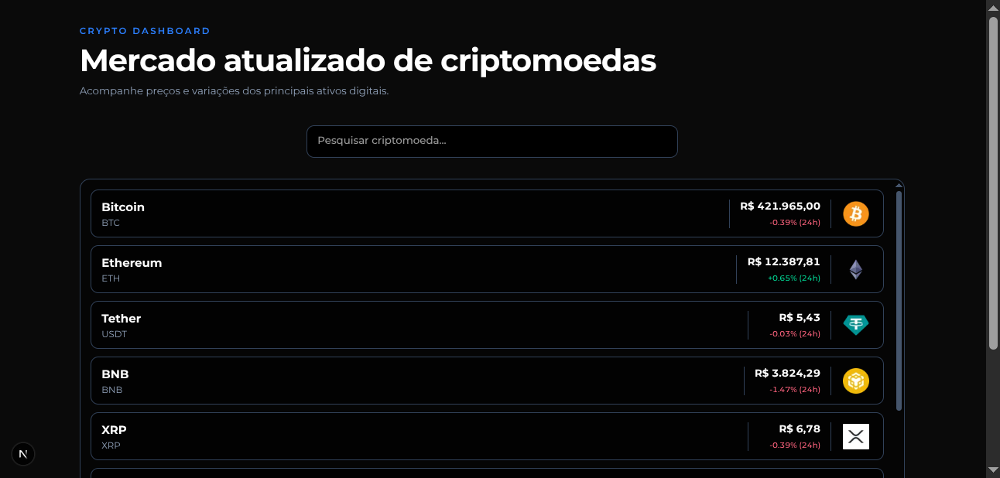

# Crypto Dashboard

Painel de acompanhamento do mercado de criptomoedas, desenvolvido com Next.js e TypeScript. Permite acompanhar preços, variações nas últimas 24 horas e pesquisar diferentes ativos digitais.




## Funcionalidades

- Listagem das principais criptomoedas por capitalização de mercado.
- Exibição de preços em reais (BRL) e variação percentual nas últimas 24 horas.
- Busca de criptomoedas com debounce.
- Estados de carregamento, erro e resultados vazios.
- Cancelamento de requisições com AbortController.
- Interface responsiva com apresentação dos ativos em cards.

## Tecnologias

- Next.js 16 (App Router)
- TypeScript
- React
- Tailwind CSS
- CoinGecko API

**1. Clone o repositório**

```bash
git clone https://github.com/seu-usuario/crypto-dashboard.git
cd crypto-dashboard
```

**2. Instale as dependências**

```bash
npm install
```

**3. Configure as variáveis de ambiente**

```bash
cp .env.example .env.local
```

Adicione sua chave da CoinGecko ao arquivo `.env.local`:

```env
COINGECKO_API_KEY=sua_chave_aqui
```

**4. Execute o projeto**

```bash
npm run dev
```

Acesse `http://localhost:3000`.